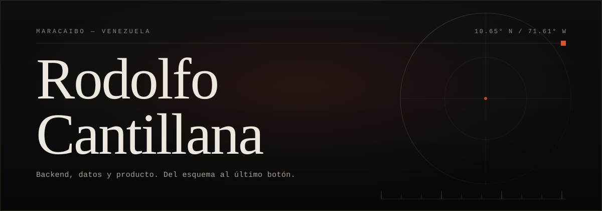

  

> Construyo backends y productos completos para negocios que necesitan cobrar, ordenar y operar todos los días. La mayor parte de ese trabajo vive en repositorios privados; aquí está lo que se puede mostrar y el mapa de lo que no.

209 commits propios · 23 repositorios con trabajo · 2022 — 2026 · Maracaibo, Venezuela

## Stack

  
  
  
  
  
  
  
  
  

  
  
  
  
  
  
  
  
  

## Trabajo seleccionado

#### Conferenz privado · perseoq

Marketplace de conferencias online pagadas: ticket digital, pagos, control de acceso individual por asistente, antifraude y cumplimiento tributario.

`Python` · `TypeScript`

#### Peluquería privado

Gestión de salón con tres roles (gerente, cajero, trabajador), precios en dólares cobrados en bolívares según la tasa del día, reparto de ganancias por porcentaje, sueldos y gastos, con estadísticas por día, semana, mes y año.

`React` · `TypeScript` · `Vite` · `NestJS` · `Prisma` · `MySQL` · `Docker` · `Traefik`

#### QuéPlan privado · perseoq

Comparador de precios de tiendas físicas para LATAM (México, Colombia, Perú, Argentina, Chile): compradores comparan, comerciantes publican su catálogo y moderadores verifican los datos.

`TypeScript` · `monorepo`

#### Rabbits privado · perseoq

Teleconsulta psicológica: videollamadas en tiempo real, pagos integrados y panel de administración. Flutter en la app móvil, NestJS en la API, React en el panel.

`Flutter` · `NestJS` · `React`

#### Conejitas privado · perseoq

Plataforma de contenido y videollamadas privadas: descubrimiento, favoritos, agenda de llamadas y compra de packs.

`Expo` · `NestJS`

#### Predial privado · perseoq

Recaudación y catastro con tres roles: administrador, cajero y contribuyente.

`TypeScript` · `Python`

Los proyectos marcados <b>perseoq</b> son colaboraciones externas en repositorios de esa organización.

### También público

- [backend-quejas](https://github.com/rdlfcantillana/backend-quejas) — backend de quejas en tiempo real con Express y Socket.IO
- [notas-app](https://github.com/rdlfcantillana/notas-app) — app de notas en React Native/Expo
- [notasbackend](https://github.com/rdlfcantillana/notasbackend) — API NestJS que alimenta la app de notas

Otros: [complaints-line](https://github.com/rdlfcantillana/complaints-line) · [faceline_back](https://github.com/rdlfcantillana/faceline_back) · [rotentomatosbackend](https://github.com/rdlfcantillana/rotentomatosbackend) · [login-final](https://github.com/rdlfcantillana/login-final) · [login_node_definitivo](https://github.com/rdlfcantillana/login_node_definitivo) · [computacion_grafica](https://github.com/rdlfcantillana/computacion_grafica) · [proyecto_nodejs](https://github.com/rdlfcantillana/proyecto_nodejs)

## Contacto

Abierto a conversar sobre backends, productos con pagos y sistemas de gestión.

**[github.com/rdlfcantillana](https://github.com/rdlfcantillana)**

<!-- Rellenar cuando quieras mostrarlos, o borrar este bloque:
**Email** — tu-correo@dominio.com
**LinkedIn** — https://www.linkedin.com/in/tu-usuario/
-->

spicyarepa-gang — Latam Python Developers · UnMundoChiquito
